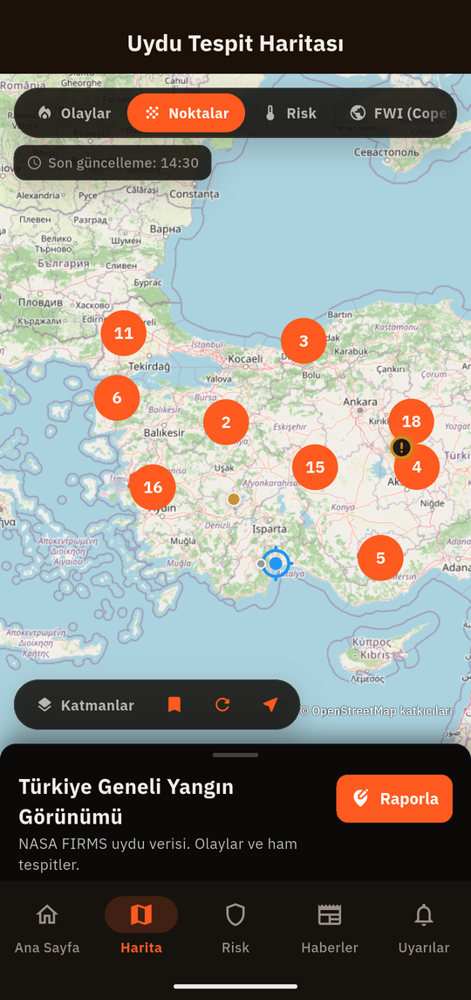
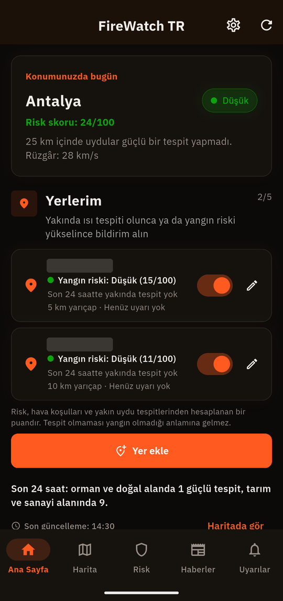
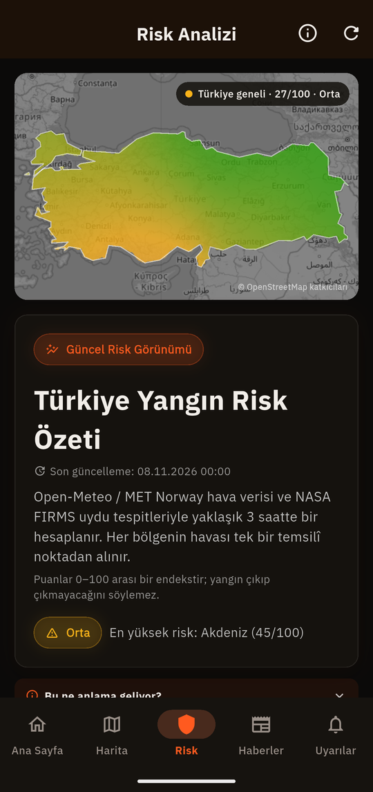
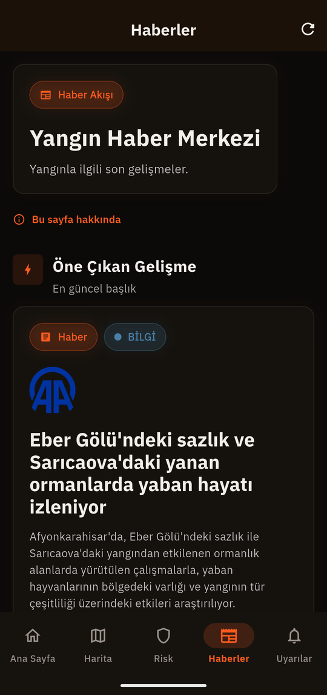
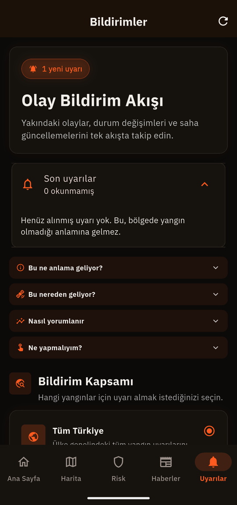
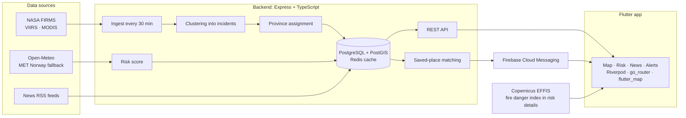

# FireWatch TR

**A free Android app that shows satellite heat detections across Türkiye and says plainly what that data can and cannot tell you.**

[](https://play.google.com/store/apps/details?id=com.oguzh.firewatch.firewatch_tr)


**[Google Play](https://play.google.com/store/apps/details?id=com.oguzh.firewatch.firewatch_tr)** · [Backend repository](https://github.com/OrhanIzmirli/firewatch-tr-backend) · [Privacy policy](https://firewatch-tr-backend.onrender.com/privacy)

Built as a small team project; this README focuses on the parts I built.

| Satellite detections | Home and saved places | Risk |
|---|---|---|
|  |  |  |

| News | Alerts |
|---|---|
|  |  |

Screenshots are from version 1.2.0 with the Turkish interface. Saved-place names and map pins are masked.

> FireWatch TR is not an emergency service and does not forward reports to any authority. A satellite sees heat, not a confirmed fire. If you see fire or smoke, call 112.

## Highlights

- **Incidents, not only dots.** Detections from NASA FIRMS (VIIRS and MODIS) are clustered into incidents on the backend, and the map shows both.
- **Saved places.** Follow up to five locations with a 5, 10 or 25 km radius and get a push notification for nearby detections or rising risk. Matching happens on the server.
- **A risk score you can check.** A 0 to 100 index from weather and nearby detections, recalculated about every 3 hours for seven regions. The app shows the formula and says the score is not a probability.
- **Private by default.** No account, no ads and no tracking software. Stored locations are rounded to about 1 km.
- **Turkish and English**, with 300+ automated tests.

## Architecture



This repository is the client. Ingestion, clustering and scoring live in the [backend](https://github.com/OrhanIzmirli/firewatch-tr-backend).

## Engineering decisions

**Honest labels.** The words in the app have to match what the data supports. A detection is called a heat detection, never a live fire, because stubble burning, factories and gas flares look the same from orbit. Fixed heat sources are labelled, not hidden. "No detection" always comes with a reminder that it does not mean no fire. Features that would run on sample data are hidden in release builds, and a test fails if unverified claims come back into the text.

**Privacy as a rule in code.** The exact position is used once, to find the province, and only a value rounded to two decimals (about 1 km) is stored. A nightly job removes inactive devices and fire reports after 90 days. Settings has a one-tap action that deletes the device and all its saved places. Backend tests check that every write path follows these rules.

**Province assignment from real boundaries.** The first version picked the nearest province centre, and a check showed that a quarter of incidents near borders got the wrong province. Now the backend uses the 81 real province polygons, and the app ships the same boundary file. Both repositories pin its SHA-256, so they cannot drift apart.

**An accuracy audit of every displayed figure.** Before version 1.2.0, the app was compared with raw sources, and the findings are in the [audit report](DOGRULUK-RAPORU.md) (Turkish):

| Checked | Against | Result |
|---|---|---|
| Thermal detections | NASA FIRMS NOAA-20 file | 98 of 98 rows match |
| Incident time, position, power | Same NASA file | 25 of 25 match |
| Weather | Raw Open-Meteo response | 7 of 7 regions match |
| Risk scores | Recalculated by hand | 7 of 7 match |
| News | Each source page opened | 100 of 100 real articles |

The data held up. The wording did not: 19 problems were found and fixed. The most serious was a message telling people who reported a fire that emergency services had been informed, when nothing was forwarded. It now tells them to call 112. Items that could not be checked independently, such as the EFFIS area figures, are marked as unverified in the report.

## Tech stack

| Area | Tools |
|---|---|
| App | Flutter, Dart, Riverpod, go_router, flutter_map, Dio |
| Notifications | Firebase Cloud Messaging |
| Localisation | Flutter `gen-l10n`, Turkish and English |
| Backend | Node.js, TypeScript, Express, PostgreSQL + PostGIS, Redis |

## Tests

300+ automated unit and widget tests run with `flutter test`.

## Limits

Satellites pass only a few times a day, cannot see through cloud or smoke, and NASA's processing adds delay. Risk is calculated from one representative point per region.

## Run it locally

```bash
flutter pub get
flutter run
```

The app uses the public backend by default. To use your own, add `--dart-define=BACKEND_BASE_URL=http://your-host:5000`.

## Data and attribution

Fire data from NASA FIRMS. Weather from Open-Meteo and MET Norway. Fire Weather Index from Copernicus EFFIS. Burned-area statistics from OGM. Map data and province boundaries © OpenStreetMap contributors (ODbL), boundaries through geoBoundaries. FireWatch TR is not affiliated with any of these organisations.

## Author

Orhan Izmirli, Computer Science student in Warsaw.
